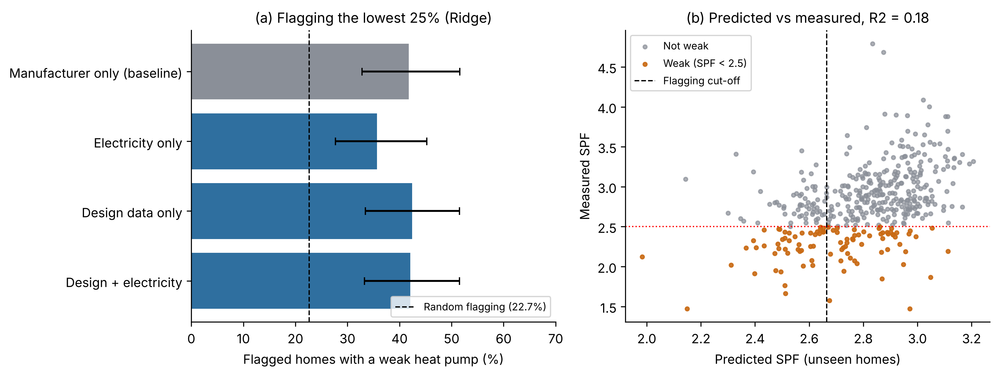

# Screening for underperforming heat pumps with smart meter and design data

How much can we learn about a heat pump's real efficiency without a heat meter? This project tests that on 428 air-source heat pumps from the UK Electrification of Heat (EoH) trial, where every system has a heat-metered seasonal performance factor (SPF) to check against.

A heat pump is counted as underperforming if its annual SPF at the H4 boundary is below 2.5. The models only use data a utility or installer could realistically hold: MCS design and installation records, daily whole-system electricity and outdoor temperature.

## Main findings

- Flagging the 25% of homes with the lowest predicted SPF finds underperforming systems at 42% precision, against 23% for random selection.
- Ridge regression did as well as random forest and LightGBM, so the limit is the information in the inputs rather than the model.
- Annual electricity on its own is almost unrelated to SPF. It mostly reflects how much heat a home needs.
- A rule based only on the manufacturer does about as well at the 25% cut-off. The model adds value in ranking all homes and in separating good and poor systems from the same manufacturer.
- Measured flow temperature adds the most information. Half-hourly electricity adds little over daily data.

All results are out of sample (5-fold cross-validation repeated 10 times) with bootstrap 95% intervals, and the conclusions hold for thresholds between 2.3 and 2.7.

| Inputs (Ridge regression) | Weak among flagged homes | Rank correlation with SPF | R² |
|---|---|---|---|
| Random flagging | 22.7% | | |
| Manufacturer only | 41.8% | 0.22 | 0.10 |
| Daily electricity only | 35.7% | 0.33 | 0.07 |
| Design data only | 42.4% | 0.38 | 0.13 |
| Design + daily electricity (main model) | 42.1% | 0.45 | 0.18 |
| Main model + measured flow temperature | 51.4% | 0.59 | 0.31 |

More figures are in [`figures`](figures).

## Notebooks

| Notebook | Content |
|---|---|
| [01_data_preparation](notebooks/01_data_preparation.ipynb) | Selects the 428 homes, checks the SPF definition and cleans daily electricity |
| [02_model_inputs](notebooks/02_model_inputs.ipynb) | Builds 31 inputs, including an energy signature for each home |
| [03_models](notebooks/03_models.ipynb) | Compares Ridge, random forest and LightGBM with nested cross-validation |
| [04_explanations_and_checks](notebooks/04_explanations_and_checks.ipynb) | Why electricity alone falls short, manufacturer effects and robustness checks |
| [05_flow_temperature](notebooks/05_flow_temperature.ipynb) | Value of measured flow temperature data |

## Running the notebooks

The notebooks are written for Google Colab and read the data from Google Drive.

1. Download the data listed below and put `summary.csv`, `property.csv` and `eoh_cleaned_daily.csv` in `MyDrive/EoH_project/`.
2. Run the notebooks in order. Each one saves its outputs to `MyDrive/EoH_project/q1_paper/` for the next.

Notebook 3 takes about 20 minutes and the others a few minutes each. To run them locally, install `requirements.txt` and change the Drive paths in the first code cell. Step 7 of notebook 4 uses half-hourly features from an earlier pipeline that is not included here; it is skipped if that file is missing.

## Data

The data are not included in this repository. They were produced by Energy Systems Catapult for the Department for Energy Security and Net Zero and are available from the UK Data Service:

- Daily performance data: Electrification of Heat Demonstration Project: Heat Pump Performance Cleansed Data: Daily Performance Dataset, 2020-2023. UK Data Service, SN 9210. https://doi.org/10.5255/UKDA-SN-9210-1
- Summary and property data: EoH heat pump performance cleansed data, UK Data Service, SN 9050.

## Status

A journal paper based on this work is in preparation.

## Author

Ali Khorshidian, MSc Renewable Energy, Liverpool John Moores University
[LinkedIn](https://www.linkedin.com/in/ali-khorshidian)

## Licence

The code is released under the MIT Licence. The data remain under their original licence.
